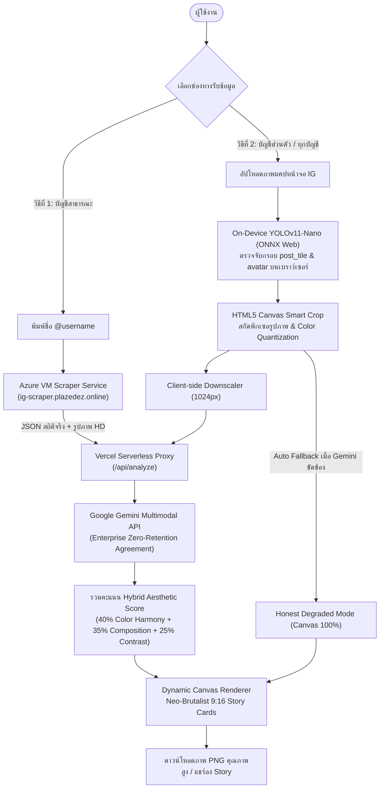

# ✨ IGOTYOU — Your Instagram Profile, Unwrapped

> **"See yourself, a little differently — Made for fun, not for judgment"**  
> *A Human-Centric, Privacy-Preserving Aesthetic Profiler & Story Card Generator via Explainable AI*

[](https://react.dev/)
[](https://tailwindcss.com/)
[](https://www.typescriptlang.org/)
[](https://vitejs.dev/)
[](https://onnxruntime.ai/)
[](https://github.com/PONGTHAKORN2007/IGOTYOU)
[](https://opensource.org/licenses/MIT)

🌐 **Live Website:** [https://igotu.plazedez.online](https://igotu.plazedez.online)

---

## 📖 สารบัญ (Table of Contents)
- [ภาพรวมของโปรเจกต์ (Overview)](#-ภาพรวมของโปรเจกต์-overview)
- [สถาปัตยกรรมระบบ (System Architecture)](#-สถาปัตยกรรมระบบ-system-architecture)
- [ฟีเจอร์เด่น (Core Features)](#-ฟีเจอร์เด่น-core-features)
- [โมเดล Machine Learning (Custom YOLOv11)](#-โมเดล-machine-learning-custom-yolov11)
- [จริยธรรมในปัญญาประดิษฐ์ (Ethics in AI)](#-จริยธรรมในปัญญาประดิษฐ์-ethics-in-ai)
- [การติดตั้งและรันในเครื่อง (Local Development)](#-การติดตั้งและรันในเครื่อง-local-development)
- [โครงสร้างโค้ด (Project Structure)](#-โครงสร้างโค้ด-project-structure)
- [การทดสอบระบบ (Automated Tests)](#-การทดสอบระบบ-automated-tests)
- [เกี่ยวกับวิชาและลิขสิทธิ์ (Academic Context & License)](#-เกี่ยวกับวิชาและลิขสิทธิ์-academic-context--license)

---

## 🌟 ภาพรวมของโปรเจกต์ (Overview)

**IGOTYOU** คือเว็บแอปพลิเคชันที่นำเสนอแนวคิด **"Instagram Wrapped"** ผ่านมุมมองสุนทรียศาสตร์ทางศิลปะ (Aesthetics) และจิตวิทยาเชิงบวก โดยนำโปรไฟล์ Instagram ของผู้ใช้มาวิเคราะห์มู้ดแอนด์โทน สกัดกลุ่มสีเด่น (Color DNA) และประเมินคะแนนการคุมโทนภาพถ่ายอย่างโปร่งใสตามหลักการทางวิทยาศาสตร์ จากนั้นเรนเดอร์ออกมาเป็นการ์ดสรุปผลงานระดับไฮเอนด์ **9:16 Story Cards สไตล์ Neo-Brutalism** ที่พร้อมเซฟและแชร์ลงโซเชียลมีเดียได้ทันที

---

## 🏗️ สถาปัตยกรรมระบบ (System Architecture)

ระบบออกแบบด้วยแนวคิด **Dual Ingestion Architecture** เพื่อให้ผู้ใช้สามารถเลือกวิธีประมวลผลข้อมูลได้ตามความต้องการ:



---

## 🚀 ฟีเจอร์เด่น (Core Features)

1. **Dual Ingestion (2 ช่องทางรับข้อมูล):**
   * **Direct Scraper:** สำหรับบัญชีสาธารณะ ดึงข้อมูลสถิติจริง (Followers, Following, Posts Count) และภาพความละเอียดสูงโดยตรง
   * **Screenshot Ingestion:** สำหรับบัญชีส่วนตัว (Private Account) อัปโหลดภาพแคปหน้าจอแล้วรันโมเดล YOLO ตัดกรอบภาพบนเบราว์เซอร์
2. **Color DNA & Aesthetic Palette:**
   * สกัดพาเลตต์สีเด่น 4 สี ด้วยเทคนิค **Weighted Color Quantization (3D RGB Histogram Binning)** พร้อมระบบชดเชยน้ำหนักสีสดใสไม่ให้สีขาว/ดำกลืนโทนภาพ
3. **Scientific & Explainable Aesthetic Scoring:**
   * สูตรคำนวณโปร่งใส **(Color Harmony 40%, Composition & Grid Rhythm 35%, Contrast Range 25%)** คะแนนอยู่ระหว่าง 25–98 คะแนน ไร้การสุ่มหลอก
4. **Per-Tile Multimodal Scoring & Top Content (#1, #2, #3):**
   * ประเมินคุณภาพภาพถ่ายรายใบ ผสานมุมมองของ Gemini Vision เพื่อคัดเลือกรูปเด่นที่สุด 3 รูป พร้อมเปิดให้ผู้ใช้กดสลับหรืออัปโหลดรูปเองได้อิสระ (**Human-in-the-Loop**)
5. **Generative Roast & Bio Remix:**
   * สร้างคำแซวที่สุภาพ น่ารัก (Constructive Satire / Gentle Roast) และรีมิกซ์คำอธิบายไบโอใหม่ด้วย AI โดยมี System Guardrails ควบคุม
6. **Instagram Wrapped 9:16 Story Cards:**
   * เรนเดอร์การ์ดสรุปผลงานระดับไฮเอนด์ สไตล์ Neo-Brutalist ดีไซน์คมชัด พร้อมส่งออกเป็นภาพ PNG คุณภาพสูง หรือเปิดดูแบบ Story Carousel
7. **Honest Degraded Fallback Mode:**
   * หากบริการ AI ภายนอกขัดข้อง ระบบจะตัดเข้าสู่โหมดประมวลผลบนเครื่องผ่าน Canvas + YOLO ทันที โดยไม่สร้างข้อมูลเท็จหลอกผู้ใช้

---

## 🤖 โมเดล Machine Learning (Custom YOLOv11)

โปรเจกต์นี้มีโมเดล Custom Vision ที่นักศึกษาพัฒนาและเทรนด้วยตนเอง:
* **สถาปัตยกรรมโมเดล:** YOLOv11-Nano (`yolo11n.pt`) ปรับแต่งและแปลงเป็น ONNX (`public/models/ig_detector.onnx`, ขนาด ~10.6 MB)
* **แพลตฟอร์มการเทรน:** Google Colab GPU (T4/L4) ผ่านโน้ตบุ๊ก [`colab/IGOTYOU_YOLO_Trainer.ipynb`](colab/IGOTYOU_YOLO_Trainer.ipynb)
* **คลาสที่ตรวจจับ (5 Classes):**
  1. `0: post_tile` — กล่องรูปภาพแต่ละโพสต์ในกริด
  2. `1: avatar` — รูปโปรไฟล์ผู้ใช้
  3. `2: ig_stats_bar` — แถบสถิติจำนวนโพสต์/ผู้ติดตาม
  4. `3: ig_tab_bar` — แถบแท็บสลับ Grid/Reels/Tagged
  5. `4: empty_or_private` — สถานะโปรไฟล์ว่างหรือเป็นบัญชีส่วนตัว
* **การรันในโปรดักชัน:** รันบนเบราว์เซอร์ของผู้ใช้ผ่าน **ONNX Runtime Web (WASM)** บนหน่วยความจำ RAM ชั่วคราว

---

## ⚖️ จริยธรรมในปัญญาประดิษฐ์ (Ethics in AI)

โปรเจกต์นี้สร้างขึ้นโดยยึดมั่นในกรอบจริยธรรมสากล (*NIST AI RMF 1.0, ISO/IEC 42001, ACM Code of Ethics, PDPA, GDPR*):

| มิติทางจริยธรรม | แนวทางวิศวกรรมที่ใช้ใน IGOTYOU |
| :--- | :--- |
| **Bias & Fairness** | • **Cultural Saturation Compensation:** ชดเชยคะแนนสีสดใสเพื่อให้ภาพสไตล์เอเชียได้รับคะแนนอย่างเป็นธรรมเทียบเท่าฟีดมินิมอลตะวันตก<br>• **Strict Non-Biometric Rule:** ตัดสินเฉพาะคุณสมบัติแสงสีทางศิลปะ ห้ามวิเคราะห์ใบหน้า สีผิว หรือรูปร่างบุคคล 100% (ยึดหลัก *Kantian Deontology: Human Dignity*) |
| **Privacy & Storage** | • **Zero-Retention on Server:** เซิร์ฟเวอร์ทำงานแบบ Stateless Proxy ไม่มีการติดตั้งฐานข้อมูล (No Database / No S3) สลายข้อมูลใน RAM ทันทีหลังส่งผลลัพธ์ (0 วินาที)<br>• **Data Minimization:** ย่อขนาดภาพเหลือ 1024px ก่อนส่งวิเคราะห์<br>• **Google Enterprise Agreement:** เชื่อมต่อกับ Gemini API ภายใต้ข้อตกลงที่จะไม่นำข้อมูลไปเทรนโมเดลต่อ |
| **Transparency** | • **Explainable AI (XAI):** เปิดเผยสูตรคะแนน 40:35:25 บนหน้า How It Works อย่างตรงไปตรงมา ไม่ใช้โมเดลกล่องดำ |
| **Accountability** | • **Safety Guardrails:** จำกัดข้อความ AI ให้เป็น Constructive Satire (หยอกล้ออย่างสร้างสรรค์) ห้ามโจมตีตัวบุคคล<br>• **Legal Disclaimers:** ระบุชัดเจนว่าคะแนนสร้างขึ้นเพื่อความบันเทิงและแรงบันดาลใจ ไม่ใช่การตัดสินคุณค่าบุคคล |
| **Human Agency** | • **Human-in-the-Loop:** ผู้ใช้มีสิทธิ์กดเปลี่ยน สลับลำดับรูป หรืออัปโหลดรูปที่ตนเองมั่นใจที่สุดมาแทนที่ได้อิสระ |

---

## 💻 การติดตั้งและรันในเครื่อง (Local Development)

### ข้อกำหนดเบื้องต้น (Prerequisites)
- [Node.js](https://nodejs.org/) (เวอร์ชัน 18 ขึ้นไป แนะนำ Node.js 20+)
- `npm` หรือ `pnpm`

### ขั้นตอนการรัน
1. **โคลนคลังโค้ด:**
   ```bash
   git clone https://github.com/PONGTHAKORN2007/IGOTYOU.git
   cd IGOTYOU
   ```

2. **ติดตั้ง Dependencies:**
   ```bash
   npm install
   ```

3. **ตั้งค่า Environment Variables:**
   สร้างไฟล์ `.env.local` ในโฟลเดอร์ราก (Root Directory):
   ```env
   GEMINI_API_KEY=your_google_gemini_api_key_here
   SCRAPER_ENDPOINT_URL=https://ig-scraper.plazedez.online
   SCRAPER_API_SECRET=your_scraper_secret_if_applicable
   ```

4. **เริ่มรัน Development Server:**
   ```bash
   npm run dev
   ```
   เปิดเบราว์เซอร์ไปที่ `http://localhost:5173`

5. **ทดสอบ Build สำหรับ Production:**
   ```bash
   npm run build
   npm run preview
   ```

---

## 📁 โครงสร้างโค้ด (Project Structure)

```text
IGOTYOU/
├── api/                        # Vercel Serverless Functions
│   ├── analyze.ts              # Stateless Gemini Multimodal Proxy
│   └── scrape.ts               # Proxy ส่งต่อไปยัง Scraper Service
├── colab/                      # Google Colab Machine Learning
│   └── IGOTYOU_YOLO_Trainer.ipynb # สคริปต์เทรนโมเดล YOLOv11 บน GPU
├── functions/                  # Cloudflare Pages Functions (Alternative)
├── public/                     # Static Assets & ML Models
│   ├── models/                 # โมเดล YOLO ที่เทรนแล้ว (ig_detector.onnx)
│   └── og-image.png            # Open Graph Meta Images
├── scraper-server/             # ไมโครเซอร์วิส Scraper สำหรับรันบน Azure VM
├── src/                        # ซอร์สโค้ดหลักของ Frontend
│   ├── components/             # คอมโพเนนต์ UI (Navbar, Modals, Story Cards)
│   ├── pages/                  # หน้าเว็บ (HomePage, ResultPage, HowItWorks, Terms)
│   ├── utils/                  # Core Engines & Logic
│   │   ├── analysisEngine.ts   # ไฮบริดเอนจินคำนวณคะแนน & ประสานงาน AI
│   │   ├── colorExtractor.ts   # สกัดสี Color Quantization & Smart Crop
│   │   ├── scoring.test.ts     # Automated Unit Tests
│   │   └── yoloDetector.ts     # ONNX Runtime Web Client-side Detector
│   ├── App.tsx                 # คอมโพเนนต์หลักและระบบ Routing
│   ├── index.css               # สไตล์สากลและ Tailwind CSS v4 Theme
│   └── main.tsx                # จุดเริ่มต้นของแอปพลิเคชัน React
├── index.html                  # HTML Shell
├── package.json                # Dependencies และคำสั่งสคริปต์
├── tsconfig.json               # การตั้งค่า TypeScript
├── vercel.json                 # การตั้งค่า Vercel Routing & Security Headers
├── vite.config.ts              # การตั้งค่า Vite Build Tooling
└── wrangler.jsonc              # การตั้งค่า Cloudflare Workers Deployment
```

---

## 🧪 การทดสอบระบบ (Automated Tests)

โปรเจกต์นี้มีชุดทดสอบอัตโนมัติ (Automated Unit Tests) ครอบคลุมฟังก์ชันคำนวณคะแนน, การตรวจสอบรูปโปรไฟล์, การตรวจจับ Bounding Box, และการสกัดสี:

```bash
npm test
```

ผลการทดสอบ: **25/25 Tests Passed (100% Pass Rate)** 🟢

---

## 🎓 เกี่ยวกับวิชาและลิขสิทธิ์ (Academic Context & License)

* **วิชา:** 05506015 Computer Ethics and Professional Issues (ปีการศึกษา 1/2569)  
* **อาจารย์ผู้สอน:** อ. รุ่งรัตน์ เวียงศรีพนาวัลย์, ภาควิชาวิทยาการคอมพิวเตอร์และสารสนเทศ มหาวิทยาลัยเทคโนโลยีพระจอมเกล้าพระนครเหนือ  
* **ใบอนุญาต (License):** โปรเจกต์นี้เผยแพร่ภายใต้สัญญาอนุญาต [MIT License](LICENSE)  
* **ข้อจำกัดความรับผิดชอบ:** โปรเจกต์นี้เป็นโครงงานศึกษาทางวิชาการเพื่อการศึกษาและวิจัยด้านจริยธรรม AI ไม่มีส่วนเกี่ยวข้อง เป็นทางการ หรือได้รับการสนับสนุนจาก Meta Platforms, Inc. หรือ Instagram แต่อย่างใด
